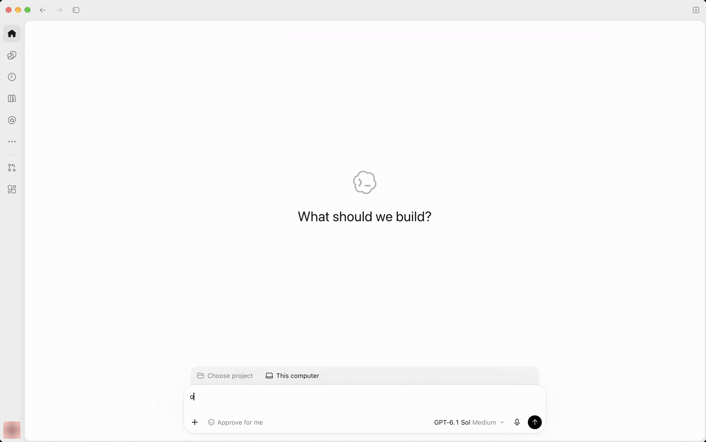
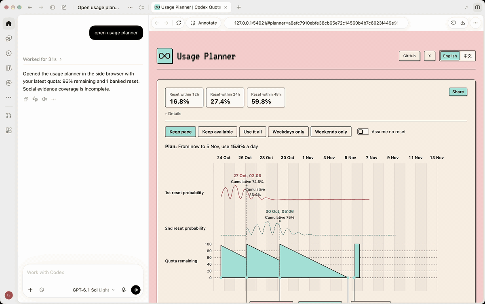
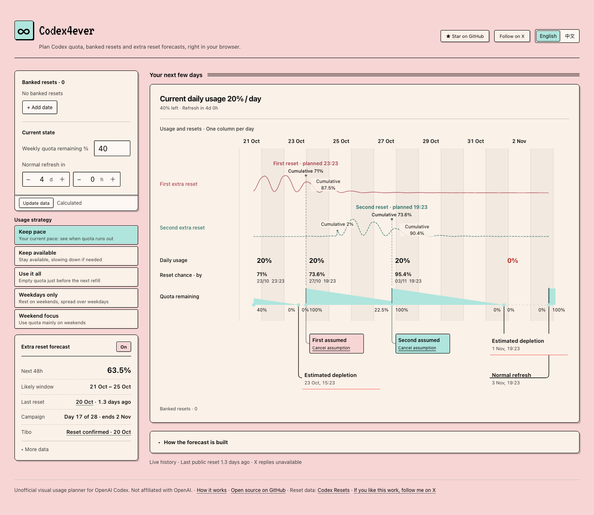

# Usage Planner — Codex quota & reset planner

<p align="center">
  
</p>

<p align="center"><strong>Know how much Codex to use today.</strong></p>

<p align="center">If you find it useful, a ⭐ star helps more people find it.</p>

<p align="center"><a href="https://usageplanner.com"></a><br />
<sub>Runs in your browser · no sign-in · or ask Codex with the plugin</sub></p>

<p align="center">
  <a href="LICENSE"></a>
  <a href="https://x.com/ItsOdeLeo"></a>
  <a href="https://xhslink.com/m/18bjTTf180W"></a>
</p>

<p align="center"><strong>English</strong> · <a href="#中文简介">中文简介</a></p>

Usage Planner (formerly Codex4ever) is a planner for your OpenAI Codex weekly quota. It shows when your quota runs out at your current pace, whether a predicted extra reset is likely to arrive first, and when a banked reset is worth redeeming.

Unofficial; not affiliated with OpenAI. MIT licensed.

## Pick a strategy

Ask once in Codex and the planner opens beside the chat. Pick a strategy and the plan changes: daily usage, refills and run-out points.

<p align="center"></p>

## What it does

- **Timeline of your next two weeks** — daily usage, remaining quota, run-out points, outages, normal refreshes and banked-reset uses, one column per day.
- **Extra-reset forecast** — the chance of an automatic reset in the next 48 hours, the likely window, and a second reset conditioned on the first, built from public reset history and Tibo's public posts.
- **Five strategies** — *Keep pace* (your current pace: see when quota runs out), *Keep available*, *Use it all* (empty quota just before the next refill), *Weekdays only*, *Weekend focus*.
- **Codex plugin** — reads your local, signed-in quota and banked resets, plans in the conversation, and opens the same visual planner.

## How it plans

- A predicted reset is **counted only when it is at least 60% likely** before the refresh in effect, and it is placed at a **conservative time** (where it has most probably already happened), not at its single most likely hour. You can switch the count to 0, 1 or 2 on the timeline.
- **Every refill restarts the seven-day window** — a banked reset, an extra reset or the normal refresh.
- **Banked resets:** extras cover outages, earliest expiry first; the **last one is kept** for a real outage (24 h or more), and a bank about to expire can be used rather than wasted.
- **One rule everywhere:** the website, the plugin page and the plugin's MCP tools always give the same plan for the same inputs.

The forecast is an uncalibrated model estimate, not a promise. Usage Planner never redeems a reset or spends credits for you.

## Use it

**Codex plugin** (Node.js 20+ and a signed-in Codex app or CLI):

```sh
codex plugin marketplace add ItsOdeLeo/usage-planner
codex plugin add usage-planner@usage-planner
```

Start a new Codex chat and ask: *"Open quota planning."* Reading your quota is local and read-only; no separate API key is needed.

**Other MCP clients** (Claude Code, Claude Desktop, Cursor and others): the same server is on npm as [`usage-planner`](https://www.npmjs.com/package/usage-planner) and in the [MCP Registry](https://registry.modelcontextprotocol.io/v0.1/servers?search=io.github.ItsOdeLeo/usage-planner) as `io.github.ItsOdeLeo/usage-planner`. Reading your quota still needs a signed-in Codex CLI on the same machine.

```json
{ "mcpServers": { "usage-planner": { "command": "npx", "args": ["-y", "usage-planner"] } } }
```

**Website:** [usageplanner.com](https://usageplanner.com), no install. Enter your quota by hand; everything is calculated in your browser and your inputs are not sent anywhere.

<p align="center"><a href="https://usageplanner.com"></a></p>

**Run locally:**

```sh
npm install
npm run web          # http://127.0.0.1:4173/
npm test
```

## Data sources

Public reset data comes from [Codex Resets](https://codex-resets.com), including the bundled offline archive (`npm run archive:refresh`). Thanks to its maintainer. With an optional X API token, Tibo's full timeline is read directly from X.

## Development

| Command | What it does |
|---|---|
| `npm run web` | Local site with live reset evidence (cached 30 minutes) |
| `npm run site:build` | Static site in `dist/`, evidence collected at build time |
| `npm run plugin:build` | Self-contained Codex plugin in `plugins/usage-planner/` |
| `npm run mcp` | MCP server from source |
| `npm run backtest:public` | Day-by-day replay of the forecast against public history |

`.github/workflows/deploy-site.yml` rebuilds the static site every 30 minutes and deploys it to Cloudflare Pages. Optional settings (LLM classification of posts, X timeline access) are listed in `.env.example`; keys are only read at build time and never reach the browser.

Design and algorithm details: [docs/technical-notes.zh.md](docs/technical-notes.zh.md) (Chinese).

## 中文简介

Usage Planner（原名 Codex4ever）是 OpenAI Codex 每周额度的本地规划器：按你当前的速度显示额度什么时候用完、额外 reset 是否可能先到，以及备用 reset 什么时候值得用。预测的 reset 只在“正常刷新前发生的概率 ≥ 60%”时计入，并放在保守时刻；任何一次补满都会重新开始 7 天周期；备用默认至少保留一个。网页、插件页面和插件的 MCP 工具始终使用同一套规则。非官方工具，与 OpenAI 无隶属关系。详细设计见 [技术说明](docs/technical-notes.zh.md)。

## Author

Built by 欧的Leo — [@ItsOdeLeo on X](https://x.com/ItsOdeLeo) · [小红书 ItsOdeLeo](https://xhslink.com/m/18bjTTf180W). Feedback and ideas are welcome there or in [GitHub issues](https://github.com/ItsOdeLeo/usage-planner/issues).
